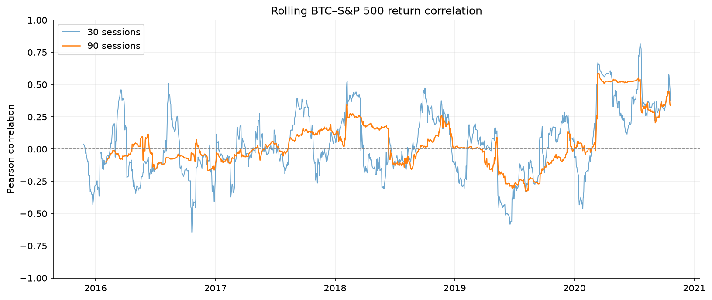
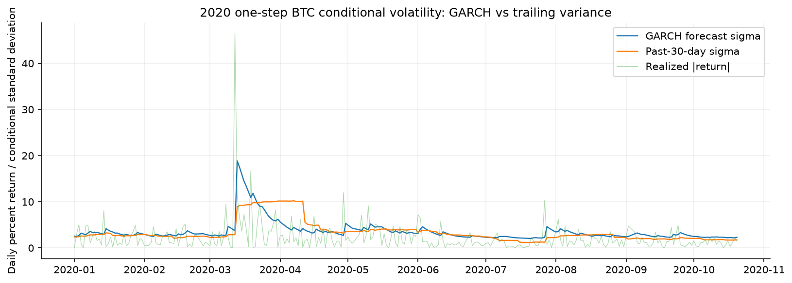
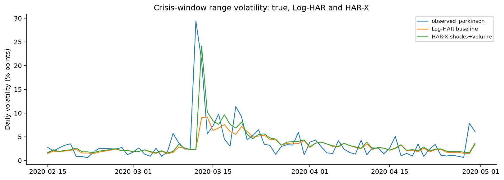
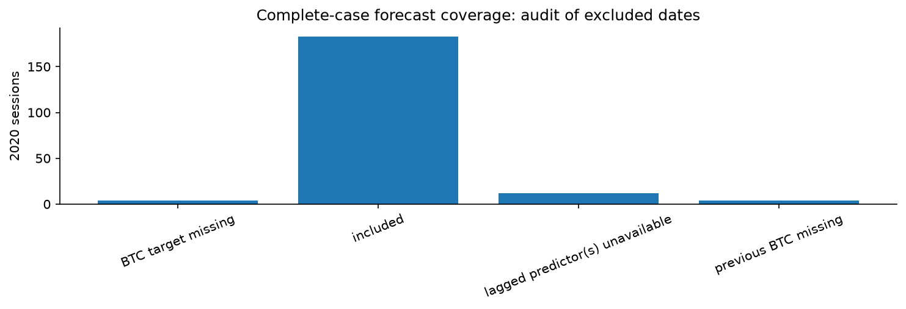
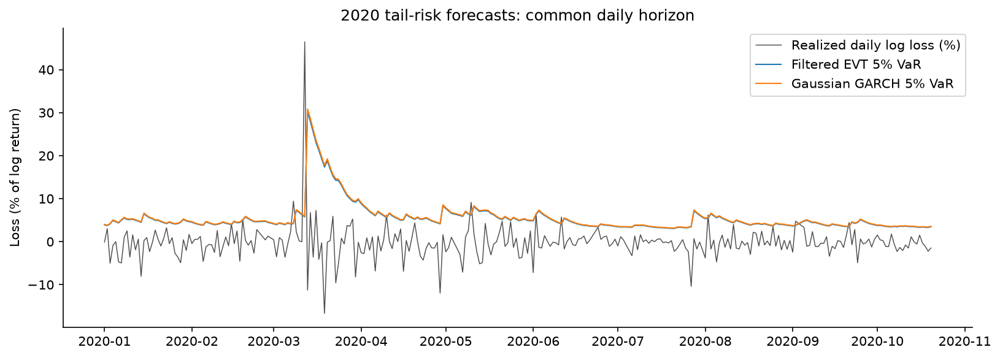
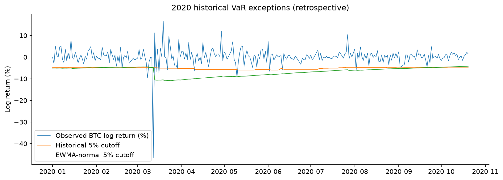
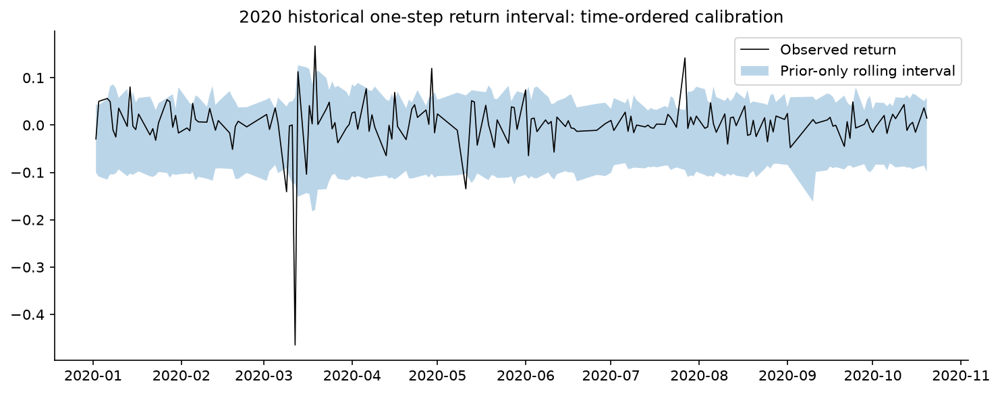

# 📈 Bitcoin Market Analysis | Regression, Volatility & Risk Modeling

## Project Overview

I started this project by exploring the relationship between Bitcoin prices and traditional U.S. equity markets, including the S&P 500 and Dow Jones.

What began as a regression analysis gradually expanded into a broader study of Bitcoin volatility forecasting, extreme market risk, and model reliability under changing market conditions.

The project combines statistical modeling, financial time-series analysis, machine learning, and risk backtesting to examine not only how models perform, but also when and why their performance changes.

A major focus of the research became understanding how data quality, feature distribution shifts, and forecast calibration influence out-of-sample results.

### Research Areas

- Bitcoin price relationships with traditional equity markets
- Regression analysis and time-series forecasting
- Volatility modeling using HAR-X and GARCH-based approaches
- Extreme risk estimation using EVT, VaR, and Expected Shortfall
- Forecast evaluation and statistical backtesting
- Feature distribution shifts and cross-provider data consistency
- Out-of-sample evaluation across different market environments

---

## Research Questions

The analysis developed around five main questions:

1. How does Bitcoin's relationship with traditional equity markets change over time?
2. How well can statistical models forecast Bitcoin volatility?
3. Can VaR and Expected Shortfall models capture extreme market losses?
4. Do forecasting results remain reliable across different market conditions?
5. How much do data quality, feature selection, and calibration affect model performance?

Rather than focusing only on prediction accuracy, the project examines the assumptions, limitations, and robustness of different modeling approaches.

---

## Dataset and Research Scope

The project uses historical Bitcoin market data and U.S. equity market information.

### Main Data

- Bitcoin price and OHLCV observations
- S&P 500 market data
- Dow Jones market data
- Engineered return, volatility, momentum, and trading volume features
- Additional BTC OHLCV observations for extended evaluation and cross-provider comparisons

### Evaluation Periods

The original historical research covers observations through October 2020, including model development and historical holdout evaluations.

The extended research also evaluates forecasting methods using data from 2021 through October 22, 2026.

The extended period is used to investigate performance under market conditions different from the original development period.

**Important:** The later evaluation period was also examined during iterative research development. Its results should be interpreted as extended out-of-sample evidence rather than a completely untouched prospective test.

Raw market datasets are not redistributed in this repository. Reproduction requires the appropriate source files, dependencies, and execution environment.

---

## Research Workflow

The project follows a structured financial modeling process:

**Data Collection → Data Cleaning → Exploratory Analysis → Feature Engineering → Model Development → Forecasting → Backtesting → Robustness Analysis**

### 1. Data Preparation

- Cleaned and standardized financial time-series data
- Aligned Bitcoin and equity market observations
- Calculated returns and volatility-related variables
- Investigated missing observations and inconsistent data coverage
- Examined differences between BTC data providers

### 2. Exploratory Analysis

- Bitcoin price and return behavior
- Rolling volatility and drawdowns
- Bitcoin–equity market correlations
- Market relationships across different regimes
- Distributional properties and extreme observations

### 3. Model Development

Developed and compared models for different research objectives, including regression, volatility forecasting, and tail-risk estimation.

### 4. Model Validation

Evaluated models using chronological observations, holdout periods, historical backtesting, calibration diagnostics, and extended out-of-sample analysis.

### 5. Robustness and Data Quality

Investigated how changes in data sources, model features, extreme observations, and calibration methods affect forecasting results.

---

## Models and Methods

### A. Regression and Market Relationships

The initial stage examined Bitcoin's relationship with traditional financial market indicators.

Methods included:

- Ordinary Least Squares (OLS) regression
- Regression diagnostics
- Rolling correlation analysis
- Market beta and stability analysis
- Cross-market relationships and lead–lag analysis

The objective was to identify statistical relationships rather than claim that equity market movements causally determine Bitcoin prices.

### B. Volatility Forecasting

The research expanded to forecast Bitcoin's time-varying volatility.

Methods included:

- Historical and rolling volatility measures
- HAR-X volatility forecasting
- Quantile HAR-X
- GARCH-based volatility modeling
- Alternative OHLC-based volatility proxies
- Forecast sensitivity and calibration analysis

The HAR-X analysis incorporated historical volatility patterns and additional market-related features.

### C. Extreme Risk Modeling

The risk analysis focused on downside losses and extreme market movements.

Models and methods included:

- Gaussian GARCH
- GARCH Filtered Historical Simulation (FHS)
- GARCH-filtered Extreme Value Theory (EVT)
- Rolling Peaks Over Threshold (POT)
- Value at Risk (VaR)
- Expected Shortfall (ES)
- Quantile-based risk methods

The goal was to understand how different assumptions affect estimates of market risk, especially during periods of financial stress.

### D. Additional Econometric Analysis

The broader research also explored structural breaks, time-varying market relationships, and related econometric approaches using Python and R.

These analyses were treated as complementary investigations rather than a single unified prediction model.

---

## Evaluation and Backtesting

Different evaluation methods were used depending on the forecasting objective.

| Research Area | Evaluation Methods |
|---|---|
| Regression | Forecast errors, residual diagnostics, holdout evaluation |
| Volatility Forecasting | MAE, QLIKE, quantile loss |
| Quantile HAR-X | Pinball Loss, exceedance rates, calibration |
| VaR Forecasting | Exception rates, coverage and independence tests |
| VaR–ES Forecasting | Joint scoring functions, including FZ0 |
| Model Comparison | Paired loss comparisons, block bootstrap, MCS |
| Robustness | Missingness, feature drift, calibration and data-provider sensitivity |

Chronological evaluation was used to respect the time-series structure of the data.

Particular attention was given to avoiding the use of future observations in forecast construction and to distinguishing historical analysis from genuinely prospective validation.

---

## Selected Research Findings

The following results come from the saved research execution and are presented as historical research findings, not independently verified live performance.

### 1. Extended HAR-X Forecast Evaluation

The HAR-X research was extended to evaluate volatility quantile forecasts from January 2021 through October 22, 2026.

A sequentially calibrated HAR-X approach was compared with a rolling 180-day benchmark over 2,090 evaluation dates.

| Metric | Sequential HAR-X | Rolling 180-Day Benchmark |
|---|---:|---:|
| 90% Quantile Pinball Loss | 3.1988 | 3.7665 |
| 95% Quantile Pinball Loss | 2.3784 | 2.9698 |

The sequentially calibrated HAR-X approach recorded lower average Pinball Loss at both evaluated quantiles.

Observed exceedance rates were approximately:

- 10.43% for the 90% volatility quantile
- 5.22% for the 95% volatility quantile

However, the sequential calibration process updates its correction using previously observed residuals. Its performance should not be interpreted as the performance of a completely fixed forecasting system.

These are **volatility quantile forecasts**, not equivalent to loss-based VaR forecasts.

### 2. Feature Distribution Shift

One of the most important findings involved the distribution of Bitcoin trading volume features.

The lagged log-volume feature showed a standardized mean shift of approximately **-7.24 training-period standard deviations** in the extended evaluation data.

This raised concerns about whether the original model inputs remained comparable across different periods and data providers.

The analysis also identified large differences in some forecasts when switching BTC data sources.

These findings motivated further investigation into:

- Trading volume measurement and units
- Cross-provider feature consistency
- Historical versus extended-period feature distributions
- Model sensitivity to unstable input variables

The observed shift does not by itself establish whether the cause was a data-unit mismatch, market evolution, or differences in provider coverage.

### 3. Volume-Ablated HAR-X

To investigate the effect of unstable volume features, additional HAR-based models were fitted without the original trading volume inputs.

These included:

- Volume-Ablated HAR-X
- Price-only HAR
- Fixed-calibration variants
- Sequential-calibration variants

The volume-excluded models produced forecasting losses broadly comparable to the original sequentially calibrated HAR-X approach.

This suggested that the additional trading volume features were not necessarily required to maintain similar forecasting performance during the evaluated period.

The experiment also demonstrated why feature selection and data consistency matter when transferring a model across market environments.

Small differences in average loss should not be interpreted as statistically established model superiority without appropriate paired comparisons.

### 4. VaR and Expected Shortfall Evaluation

The risk-model analysis compared approaches including Gaussian GARCH, GARCH-FHS, GARCH-filtered EVT, and Rolling POT.

An extended risk-model experiment generated forecasts over 2,119 common evaluation dates.

At the 95% VaR confidence level:

| Risk Model | Observed VaR Exceedance Rate |
|---|---:|
| Gaussian GARCH | 3.82% |
| GARCH-FHS | 4.86% |
| GARCH-filtered EVT | 4.81% |
| Rolling POT | 4.48% |
| Nominal Target | 5.00% |

In the extended coverage tests, Gaussian GARCH showed evidence of calibration differences relative to the nominal exceedance rate.

The other models did not show the same level of evidence against the tested unconditional coverage hypothesis.

The research also compared joint VaR–ES forecasting losses using FZ0.

These extended risk-model implementations are methodological sensitivity experiments and should not be treated as exact replications of every original historical model specification.

### 5. Statistical Risk Backtesting

The historical risk analysis included formal Expected Shortfall Regression (ESR) and Model Confidence Set (MCS) testing.

The ESR evaluation covered four risk models across the 2019 and 2020 evaluation periods.

All eight reported ESR p-values exceeded 0.05.

This means the relevant null hypotheses were not rejected at the 5% significance level; it does **not** establish that the risk forecasts were accurate or fully calibrated.

Formal MCS testing was also conducted using multiple bootstrap block lengths.

The superior model set depended on the chosen block length, illustrating that model rankings may be sensitive to the assumptions used in statistical comparison.

### 6. Model Reliability and Data Quality

Across the project, several recurring issues affected forecasting reliability:

- Missing observations
- Extreme market events
- Feature distribution shifts
- Forecast calibration choices
- Differences between BTC data providers
- Evaluation period selection
- Sensitivity to volatility proxies

These findings reinforced an important conclusion:

**Model performance cannot be evaluated independently of the data, forecasting procedure, and validation assumptions used to produce it.**

---

## Selected Research Visualizations

The following figures highlight the project's progression from market relationship analysis to volatility forecasting, data quality assessment, and financial risk modeling.

### 1. Bitcoin and S&P 500 — Rolling Correlation

Explored how Bitcoin's relationship with the S&P 500 changed over time rather than assuming a stable relationship across different market conditions.

### 2. GARCH Volatility Analysis

Examined Bitcoin's time-varying volatility using GARCH-based modeling, particularly during periods of increased market uncertainty.

### 3. HAR-X Forecasting During Market Stress

Investigated HAR-X forecasting behavior during periods of elevated volatility to understand model limitations under market stress.

### 4. Missing Data and Forecast Reliability

Examined missing observations in the historical dataset and investigated how data availability can affect the reliability of financial forecasting.

### 5. Extreme Value Theory — Tail Risk

Explored extreme market losses using EVT-based risk modeling to examine the behavior of Bitcoin during unusually large market movements.

### 6. Historical Value at Risk Backtesting

Evaluated historical VaR forecasts by examining realized losses that exceeded predicted risk thresholds.

### 7. Conditional Calibration and Model Validation

Investigated how forecast calibration changes across different market conditions, emphasizing model reliability beyond average forecasting accuracy.

---

*Research note: These figures represent selected historical analyses. Extended out-of-sample evaluations and additional validation findings are discussed in the research results section.*
---

## Technology Stack

**Languages**

- Python
- R

**Python Libraries**

- Pandas
- NumPy
- Scikit-learn
- Statsmodels
- SciPy
- Matplotlib
- Financial time-series and econometric packages

**R / Statistical Methods**

- GARCH estimation
- ESR backtesting
- Model Confidence Set testing
- Econometric robustness analysis

**Development Environment**

- Jupyter Notebook
- VS Code
- Git and GitHub

---

## Reproducibility and Project Setup

The repository includes a research notebook containing the analytical workflow.

### 1. Prepare the Environment

Install Python and Jupyter Notebook, along with the packages imported by the research code.

Where a `requirements.txt` file is provided, dependencies can be installed with:

`pip install -r requirements.txt`

Some econometric procedures also require an R installation and relevant R packages.

### 2. Prepare the Data

Place the required historical market datasets in the locations expected by the notebook, or configure the relevant input paths.

The original analysis uses Bitcoin market data alongside historical U.S. equity market observations.

Some extended analyses also require independently retrieved BTC OHLCV data.

### 3. Run the Notebook

Open the research notebook in Jupyter or VS Code and execute the analytical workflow in order.

The GitHub-clean notebook is intended for source review and may not contain previously saved execution outputs.

The full research notebook contains a more detailed development and validation history.

### 4. Review the Results

Review the generated forecasts, statistical test outputs, and execution-specific validation evidence.

External R procedures and data-provider checks require a compatible local environment.

A successful Python execution alone does not guarantee that every external econometric validation step has passed.

---

## Repository Organization

The project is organized around the research notebook and supporting analytical outputs.

A recommended public-facing layout is:

- `README.md` — Project overview, methodology, findings, and limitations
- `notebook/` — Main Jupyter research notebook
- `reports/figures/` — Selected visualizations
- `reports/results/` — Shareable summary tables and validation evidence
- `requirements.txt` — Python dependencies, when provided

The complete research environment may also contain supplementary Python and R scripts, local source datasets, and execution-specific output directories.

Machine-specific file paths and locally generated artifacts should be configured appropriately before reproducing the analysis.

---

## Limitations

Financial forecasting remains challenging, especially in cryptocurrency markets.

Important limitations of this research include:

**Data consistency:** Differences in trading volume definitions, OHLC aggregation, and provider coverage can affect model inputs and forecasts.

**Model stability:** Relationships estimated in one period may not remain stable across different market regimes.

**Calibration:** Forecast performance may depend substantially on residual calibration and updates using previously observed data.

**Statistical uncertainty:** Failure to reject a backtesting null hypothesis does not establish that a forecasting model is correct.

**Reproducibility:** Although the main Python research workflow and formal ESR/MCS procedures produced saved results, independent verification of some external BTC data definitions and explicit R GARCH convergence evidence remains incomplete.

**Extended evaluation:** The 2021–2026 period was examined iteratively during the research process, so its results should not be described as a fully untouched prospective test.

The project is intended for research, learning, and portfolio demonstration. It is not a trading recommendation or a production-ready risk management system.

---

## What This Project Demonstrates

This project reflects practical experience in:

- Financial data analysis and statistical modeling
- Regression and time-series forecasting
- Volatility and tail-risk modeling
- VaR and Expected Shortfall evaluation
- Model validation and statistical backtesting
- Data quality investigation and feature engineering
- Out-of-sample model comparison
- Interpreting model limitations and communicating research findings

The most valuable part of the project was not identifying a single best-performing model.

It was learning how data quality, model assumptions, changing market conditions, and evaluation choices can materially affect the conclusions of a financial analysis.

---

## Future Research

Potential extensions include:

- Prospective evaluation on newly observed market data
- Further cross-provider data harmonization
- Additional calibration stability and robustness testing
- Expanded Expected Shortfall model comparisons
- CARE and Student-t GARCH as separate follow-up research
- More automated reproducibility and reporting workflows

These are potential extensions rather than completed components of the current study.

---

## Final Takeaway

This project started with a simple question about Bitcoin's relationship with traditional equity markets and developed into a broader investigation of forecasting reliability and financial risk.

One of my biggest takeaways was that **building a model is only part of the process**.

Understanding its limitations, checking data quality, and evaluating performance under changing market conditions are just as important as the model itself.

---

*Research and educational purposes only. Not financial advice.*
